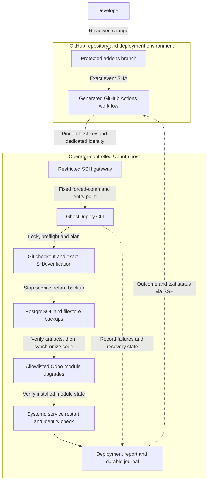

# Architecture and trust boundaries

GhostDeploy runs on the operator's Ubuntu host. The diagram shows the GitHub Actions route. A local operator with the same host permissions can invoke the CLI directly.

- The repository owner controls branch reviews, workflow permissions, environment rules and the deployment key. The host checks the exact SHA against its configured trusted branch. GitHub environment approval is enforced by GitHub. Treat possession of the dedicated key as authorization to submit the host's restricted deployment request.
- The host administrator controls the forced SSH entry point, root-owned configuration and systemd unit. An unprivileged Odoo service account uses scoped sudo for stop and start. This account executes the reviewed addon code.
- The operator controls PostgreSQL, filestore data, the checkout and private storage for backups and journals. The database allowlist scopes upgrade operations. Every database served by the unit shares the restart and may use the changed addon code.
- GitHub Actions receives the remote command outcome. Application state and recovery artifacts remain on the host. GhostDeploy requires no separate service operated by this project.

See [GitHub Actions setup](github-actions.md), [operations and recovery](operations.md) and the [security policy](../SECURITY.md).
